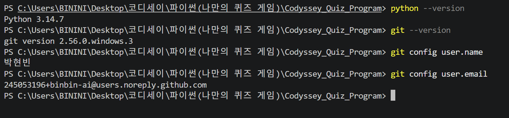
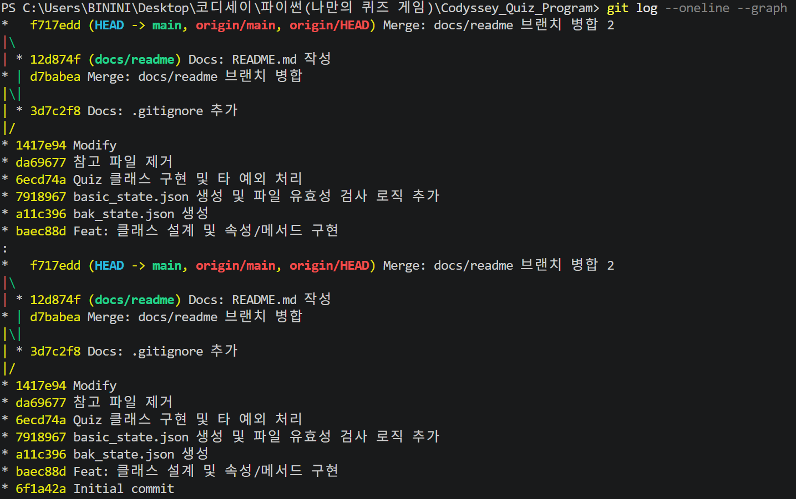
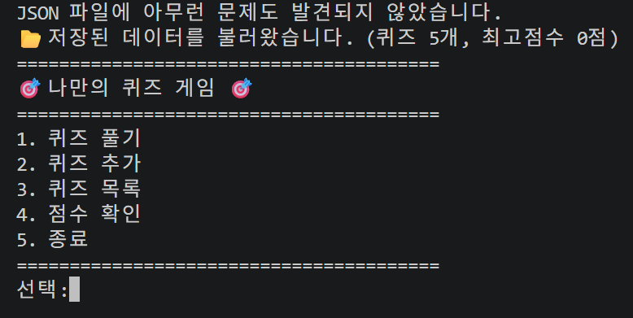
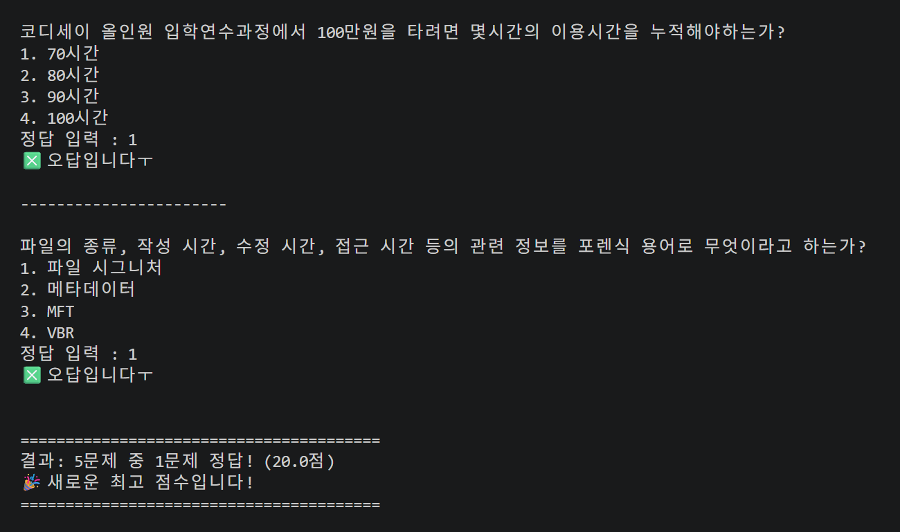
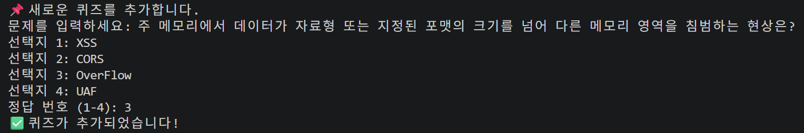
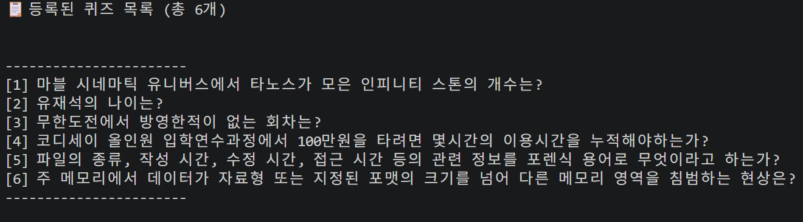
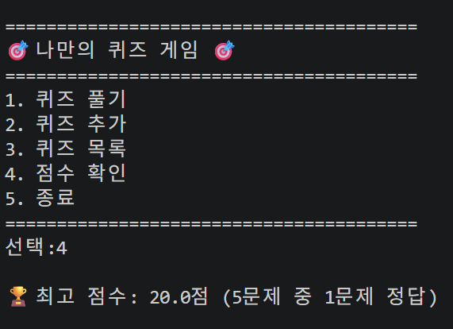

# 🎯 Codyssey Quiz Program

> Python 객체 지향 프로그래밍(OOP)과 JSON 파일 입출력을 활용해 구현한 터미널 기반 종합 상식 퀴즈 게임입니다.

## 목차

1. [프로젝트 개요](#-프로젝트-개요)
2. [퀴즈 주제 및 선정 이유](#-퀴즈-주제-및-선정-이유)
3. [실행 방법](#-실행-방법)
4. [기능 목록](#-기능-목록)
5. [입력 검증 및 예외 처리](#-입력-검증-및-예외-처리)
6. [코드 구조 (클래스 설계 및 OOP 선택 이유)](#-코드-구조-클래스-설계-및-oop-선택-이유)
7. [파일 구조](#-파일-구조)
8. [데이터 파일 설명 (`state.json`) 및 한계·대안](#-데이터-파일-설명-statejson-및-한계대안)
9. [요구사항 변경 시 수정 가이드](#-요구사항-변경-시-수정-가이드)
10. [Git 브랜치 전략 및 협업 워크플로우](#-git-브랜치-전략-및-협업-워크플로우)
11. [실행 화면 예시](#-실행-화면-예시)

---

## 프로젝트 개요

**Codyssey Quiz Program**은 외부 라이브러리 없이 Python 표준 라이브러리(`json`)만으로 동작하는 콘솔 기반 퀴즈 프로그램입니다.

단순히 문법을 나열하는 수준을 넘어, **클래스를 통한 역할 분리**, **잘못된 사용자 입력과 예기치 못한 종료 상황에 대한 안전한 예외 처리**, 그리고 **JSON 파일 저장을 통한 데이터 영속성**을 하나의 완성된 프로그램으로 구현하는 것을 목표로 제작했습니다.

* **핵심 특징**
  * `Quiz`와 `QuizGame` 클래스로 개별 문제 표현과 게임 전체 흐름의 책임을 분리
  * 프로그램을 종료하고 다시 실행해도 추가한 퀴즈와 역대 최고 점수가 유지되는 영속성 구조
  * `state.json` 누락 또는 손상 시 `basic_state.json`으로부터 자동 복구되는 안정적인 데이터 로딩

---

## 퀴즈 주제 및 선정 이유

### 선정 주제: 대중문화 · 교육 과정 · 디지털 포렌식 종합 상식 퀴즈

단일 분야로만 문제를 구성하면 특정 배경지식이 없는 사용자에게 난이도가 편향될 수 있기 때문에, **친숙한 대중문화와 실제 학습 중인 전공·교육 과정 지식**을 조화롭게 섞어 기본 퀴즈 5문항을 구성했습니다.

* **대중문화 (영화·예능):** 마블 시네마틱 유니버스(MCU), 무한도전, 유재석 등 누구나 가볍게 즐길 수 있는 문제로 진입 장벽을 낮췄습니다.
* **교육 과정 (코디세이):** 코디세이 올인원 입학연수과정 관련 문제를 포함해 미션과 학습 과정에 대한 친밀도를 높였습니다.
* **IT / 디지털 포렌식:** 파일의 메타데이터(Metadata) 등 디지털 포렌식 기초 용어를 출제하여 게임을 즐기면서 전공 개념을 자연스럽게 복습할 수 있도록 설계했습니다.

---

## 실행 방법

### 1. 개발 및 실행 환경

* **Python 3.10 이상**
* 외부 패키지 설치 불필요 (Python 기본 내장 모듈 `json`만 사용)

### 2. 저장소 복제 및 실행

터미널(CMD, PowerShell, VS Code Terminal 등)에서 아래 명령어를 순서대로 입력합니다.

```bash
# 1. 원격 저장소 복제
git clone https://github.com/binbin-ai/Codyssey_Quiz_Program.git

# 2. 프로젝트 폴더로 이동
cd Codyssey_Quiz_Program

# 3. 프로그램 실행
python Quiz_Done.py
```

> **참고:** 운영체제 환경에 따라 `python` 대신 `python3 Quiz_Done.py` 명령어를 사용해야 할 수 있습니다.

---

## 기능 목록

프로그램을 실행하면 저장된 데이터를 불러온 뒤 5가지 메뉴를 제공합니다.

| 번호 | 기능 | 상세 설명 |
| :---: | :--- | :--- |
| **1** | **퀴즈 풀기** | `state.json`에 등록된 모든 퀴즈를 순차적으로 출제합니다. 각 문항마다 1~4번 중 정답을 입력받아 즉시 정답/오답 여부를 안내하며, 종료 후 전체 정답 개수와 100점 만점 환산 점수(소수점 둘째 자리 반올림)를 출력합니다. 기존 최고 점수를 경신하면 파일에 자동 저장합니다. |
| **2** | **퀴즈 추가** | 새로운 문제 내용, 객관식 선택지 4개, 정답 번호(1~4)를 순서대로 입력받아 `state.json`에 즉시 추가하고 저장합니다. |
| **3** | **퀴즈 목록** | 현재 저장된 전체 퀴즈 개수와 모든 문제의 번호 및 질문 내용을 리스트 형태로 출력합니다. |
| **4** | **점수 확인** | 현재까지 기록된 역대 최고 점수와 당시의 전체 문제 수, 맞힌 문제 수를 확인합니다. 아직 퀴즈를 한 번도 풀지 않은 경우 안내 메시지를 출력합니다. |
| **5** | **종료** | 안내 메시지를 출력하고 프로그램을 안전하게 종료합니다. |

---

## 입력 검증 및 예외 처리

사용자의 실수나 예기치 않은 환경 오류로 프로그램이 비정상 종료되지 않도록 다음과 같은 방어 로직을 구현했습니다.

* **입력값 정규화 및 검증**
  * 모든 입력값에 `.strip()`을 적용해 앞뒤 공백이 포함되어도 정상 처리합니다.
  * 빈 문자열(공백 입력), 숫자가 아닌 문자열(`ValueError`), 허용 범위를 벗어난 숫자(메뉴 `1~5`, 정답 `1~4` 외)를 입력하면 오류 안내 메시지를 출력하고 재입력 흐름으로 복귀합니다.
* **안전한 프로그램 종료 처리**
  * 실행 중 `Ctrl + C`(`KeyboardInterrupt`) 또는 입력 스트림 종료(`EOFError`)가 발생해도 트레이스백을 출력하며 강제 종료되지 않고 안내 메시지 출력 후 안전하게 종료합니다.
* **데이터 파일 복구 및 빈 데이터 대응**
  * `state.json`이 존재하지 않거나(`FileNotFoundError`) JSON 문법이 손상된 경우(`json.JSONDecodeError`), `basic_state.json`의 기본 퀴즈 데이터로 자동 복구 및 초기화합니다.
  * 등록된 퀴즈가 0개인 경우 예외를 방지하고 안내 및 퀴즈 추가 흐름으로 안전하게 분기합니다.

---

## 코드 구조 (클래스 설계 및 OOP 선택 이유)

기능별로 책임을 명확히 나누기 위해 `Quiz`와 `QuizGame` 두 개의 클래스를 정의했습니다.

### 1. `Quiz` 클래스
개별 퀴즈 1문항의 데이터와 동작을 담당합니다.
* **속성 (Attributes):** `question` (문제), `choices` (선택지 4개 리스트), `answer` (정답 번호 `1~4`)
* **주요 메서드 (Methods)**
  * `show_quiz()`: 문제 본문 출력
  * `show_select()`: 1~4번 번호와 함께 선택지 출력
  * `check_answer()`: 사용자 정답 입력 검증 및 정답 여부 판별 (`1` 또는 `0` 반환)

### 2. `QuizGame` 클래스
전체 메뉴 흐름, 게임 상태 관리, JSON 파일 입출력을 담당합니다.
* **속성 (Attributes):** `best_score` (최고 점수)
* **주요 메서드 (Methods)**
  * `run()`: 초기 데이터 로드 안내 및 메인 메뉴 루프 제어
  * `play_quiz()`: 퀴즈 출제, 점수 계산, 최고 점수 갱신 판단
  * `add_quiz()`: 신규 퀴즈 입력 검증 및 저장 호출
  * `quiz_list()`: 등록된 퀴즈 목록 조회
  * `show_best_score()`: 최고 점수 및 기록 출력
  * `load_data()`: `state.json` 로드, 파일 부재·손상 검증 및 `basic_state.json` 복구
  * `save_data()`: 신규 퀴즈 등록 및 최고 점수 기록을 `state.json`에 UTF-8로 저장

### 3. 객체 지향(클래스 기반) 설계를 선택한 이유 (함수 기반 대비 장점)

단순한 스크립트라면 함수와 딕셔너리·전역 변수만으로도 구현할 수 있지만, 프로그램의 규모가 커질수록 **클래스 기반 객체 지향 설계**가 함수 기반(절차적) 방식보다 다음과 같은 명확한 이점을 제공합니다.

| 비교 항목 | 함수 기반(절차적) 방식 | 클래스 기반(객체 지향) 방식 (본 프로젝트) |
| :--- | :--- | :--- |
| **상태 관리와 캡슐화** | `best_score`, 퀴즈 목록 등을 전역 변수로 두거나 모든 함수에 인자로 매번 전달해야 하므로 데이터 오염과 결합도가 높아집니다. | `self.best_score`, `self.question`처럼 데이터(속성)와 이를 다루는 동작(메서드)을 객체 내부에 캡슐화하여 전역 상태 의존을 제거합니다. |
| **책임 분리와 유지보수성** | 문제 출력, 정답 검증, 게임 진행, 저장 로직이 한 파일의 함수들에 평면적으로 섞여 변경 시 영향 범위 파악이 어렵습니다. | 개별 문제 로직은 `Quiz`에, 게임 흐름·저장은 `QuizGame`에 격리되어 있어 특정 기능 수정 시 다른 영역에 미치는 부작용을 최소화합니다. |
| **확장성과 재사용성** | 힌트, 난이도, 제한 시간 등 속성이 추가되면 해당 데이터를 다루는 모든 함수의 매개변수와 내부 딕셔너리 키 참조를 일일이 수정해야 합니다. | `Quiz` 클래스에 속성·메서드만 추가하거나 상속(`TimedQuiz`, `HintQuiz` 등)을 활용해 기존 게임 루프의 변경을 최소화하며 기능을 확장할 수 있습니다. |

---

## 파일 구조

```text
Codyssey_Quiz_Program/
├── Quiz_Done.py            # 메인 실행 파일 (Quiz, QuizGame 클래스 및 전체 게임 로직)
├── state.json              # 현재 퀴즈 목록과 최고 점수 기록이 유지되는 데이터 파일
├── basic_state.json        # state.json 누락 또는 손상 시 복구에 사용되는 기본 데이터 파일
├── .gitignore              # Python 캐시(__pycache__ 등) 및 IDE 설정 제외 목록
├── docs/
│   └── screenshots/        # 프로그램 실행 결과 및 Git 이력 캡처 이미지 폴더
│       ├── menu.png        # 메인 메뉴 화면
│       ├── play.png        # 퀴즈 풀기 및 결과 화면
│       ├── add_quiz.png    # 퀴즈 추가 화면
│       └── score.png       # 최고 점수 확인 화면
└── README.md               # 프로젝트 소개 및 사용 설명서
```

---

## 데이터 파일 설명 (`state.json`) 및 한계·대안

* **파일 경로:** 프로젝트 루트 디렉터리 (`./state.json`)
* **인코딩 및 포맷:** `UTF-8` (`ensure_ascii=False`, `indent=4` 적용으로 한글 가독성 유지)
* **역할:** 사용자가 추가한 퀴즈와 퀴즈 풀이를 통해 갱신된 최고 점수를 영구 저장합니다. 프로그램 시작 시 파일이 없거나 깨져 있으면 같은 경로의 `basic_state.json`을 읽어 자동으로 복원합니다.

### JSON 스키마 예시

```json
{
    "quizzes": [
        {
            "question": "마블 시네마틱 유니버스에서 타노스가 모은 인피니티 스톤의 개수는?",
            "choices": [
                "4개",
                "5개",
                "6개",
                "7개"
            ],
            "answer": 3
        }
    ],
    "best_score": 80.0,
    "question_number": 5,
    "correct_number": 4
}
```

### 필드 상세 명세

| 필드명 | 자료형 | 설명 |
| :--- | :--- | :--- |
| `quizzes` | `list[dict]` | 등록된 전체 퀴즈 객체의 목록 |
| `quizzes[].question` | `str` | 퀴즈 문제 문자열 |
| `quizzes[].choices` | `list[str]` | 4개의 객관식 보기 목록 |
| `quizzes[].answer` | `int` | 정답 번호 (`1` ~ `4` 사이의 정수) |
| `best_score` | `int` / `float` | 역대 최고 점수 (100점 만점 기준 환산 점수) |
| `question_number` | `int` | 최고 점수를 달성했을 당시의 전체 출제 문제 수 |
| `correct_number` | `int` | 최고 점수를 달성했을 당시의 정답 개수 |

### JSON 파일 저장 방식의 한계 및 대규모 확장 대안

현재 규모(수십~수백 문항의 단일 사용자 로컬 앱)에서는 사람이 직접 읽고 수정할 수 있으며 별도 설정이 필요 없는 JSON 파일이 가장 적합합니다. 그러나 **데이터가 수만 건 이상으로 커지거나 다중 사용자 환경으로 확장될 경우** 다음과 같은 한계가 발생합니다.

* **성능 및 메모리 한계**
  * **전체 적재·전체 덮어쓰기(Full Load / Full Rewrite):** `json.load()`는 파일 전체를 파싱해 메모리에 한꺼번에 올리며, 퀴즈 1개나 점수 1줄만 변경되어도 `json.dump()`로 파일 전체를 다시 써야 하므로 데이터가 커질수록 메모리 점유율과 디스크 I/O 지연이 급격히 증가합니다.
  * **검색·필터링 비효율:** 별도의 인덱스가 없기 때문에 특정 카테고리나 키워드로 퀴즈를 찾으려면 전체 리스트를 처음부터 끝까지 순차 탐색($O(N)$)해야 합니다.
  * **동시성 및 데이터 무결성 취약:** 트랜잭션(ACID)이나 파일 잠금(Lock)을 지원하지 않아, 여러 프로세스가 동시에 쓰기를 시도하거나 저장 도중 전원이 꺼지면 파일이 손상되거나 데이터가 유실될 위험이 있습니다.
* **확장 시 권장 대안**
  * **1단계 대안 — SQLite (`sqlite3`):** Python 표준 라이브러리에 기본 내장되어 있어 별도 DB 서버 설치 없이 단일 로컬 파일로 운영할 수 있습니다. 인덱스 기반 고속 조회, 부분 수정(`INSERT`/`UPDATE`/`DELETE`), 트랜잭션을 지원하므로 로컬 프로그램의 데이터가 커졌을 때 가장 현실적인 대안입니다.
  * **2단계 대안 — 서버형 RDBMS (PostgreSQL, MySQL 등) / NoSQL (MongoDB 등):** 웹 서비스나 다중 사용자 동시 접속 환경으로 확장할 경우, 동시성 제어·백업·권한 관리·수평 확장이 가능한 전용 데이터베이스 도입이 필요합니다.

---

## 요구사항 변경 시 수정 가이드

향후 기능 확장이나 스펙 변경이 발생했을 때, 어떤 파일과 메서드를 수정해야 하는지 영향 범위를 정리했습니다.

| 변경 요구사항 예시 | 수정 대상 파일 | 수정 대상 클래스 / 메서드 및 포인트 |
| :--- | :--- | :--- |
| **선택지 개수 변경** (예: 4지선다 → 5지선다 또는 O/X) | `Quiz_Done.py`<br>`state.json`, `basic_state.json` | `Quiz.check_answer()` (입력 허용 범위 `1~4` 수정)<br>`QuizGame.add_quiz()` (선택지 입력 반복 횟수 및 정답 범위 수정)<br>기존 JSON 파일의 `choices` 길이 조정 |
| **퀴즈 속성 추가** (예: 힌트, 카테고리, 난이도) | `Quiz_Done.py`<br>`state.json`, `basic_state.json` | `Quiz.__init__()`, `Quiz.show_quiz()` (신규 속성 초기화 및 출력)<br>`QuizGame.play_quiz()` (`Quiz` 인스턴스 생성 인자 및 힌트 사용 흐름)<br>`QuizGame.add_quiz()`, `QuizGame.save_data()` (입력·저장 스키마 확장) |
| **점수 계산 방식·기록 확장** (예: 오답 감점, 점수 히스토리 저장) | `Quiz_Done.py`<br>`state.json`, `basic_state.json` | `QuizGame.play_quiz()` (점수 산출 수식 및 기록 생성)<br>`QuizGame.show_best_score()` (기록 출력 포맷 변경)<br>`QuizGame.save_data()`, `QuizGame.load_data()` (히스토리 필드 읽기/쓰기) |
| **출제 방식 변경** (예: 랜덤 출제, 문제 수 선택) | `Quiz_Done.py` | `QuizGame.play_quiz()` (`random.shuffle` 적용 및 출제 문항 수 슬라이싱 로직 추가) |
| **메뉴 항목 추가·변경** (예: 퀴즈 삭제/수정 기능 추가) | `Quiz_Done.py` | `QuizGame.run()` (메뉴 출력 문구 및 분기 번호 확장)<br>`QuizGame` 내부에 신규 메서드(예: `delete_quiz()`) 추가 및 `save_data()` 연동 |
| **저장소 교체** (예: JSON → SQLite DB 전환) | `Quiz_Done.py` | `QuizGame.__init__()` (DB 연결·테이블 초기화)<br>`QuizGame.load_data()`, `QuizGame.save_data()` (파일 입출력 로직을 SQL 쿼리로 대체) |
| **기본 퀴즈 문항 또는 파일 복구 정책 변경** | `basic_state.json`<br>`Quiz_Done.py` | `basic_state.json` (기본 문항 편집)<br>`QuizGame.load_data()` (`FileNotFoundError`, `JSONDecodeError` 시 복구 동작 수정) |
| **입력 검증·예외 처리 규칙 변경** | `Quiz_Done.py` | `Quiz.check_answer()`, `QuizGame.run()`, `QuizGame.add_quiz()` (공통 검증 헬퍼 메서드로 추출 시 단일 지점에서 관리 가능) |

---

## Git 브랜치 전략 및 협업 워크플로우

본 프로젝트는 단일 파일 실습에 그치지 않고 실무 협업 흐름으로 자연스럽게 확장할 수 있도록 **브랜치 기반 개발과 의미 있는 커밋 단위**를 적용했습니다.

### 1. 브랜치를 분리하는 이유

* **안정적인 기준선(`main`) 보호:** `main` 브랜치는 항상 정상 실행·배포 가능한 완성 상태를 유지해야 합니다. 미완성 코드나 실험적인 수정을 `main`에 직접 커밋하면 전체 프로그램이 깨질 수 있으므로, 별도 브랜치에서 작업한 뒤 검증이 끝난 코드만 병합합니다.
* **작업 단위의 독립성 확보:** 여러 기능(예: 퀴즈 출제 로직 개선과 README 작성)을 동시에 진행하더라도 브랜치를 분리하면 변경 이력이 섞이지 않으며, 특정 기능에 문제가 생겼을 때 해당 브랜치만 안전하게 되돌리거나 수정할 수 있습니다.
* **코드 리뷰 및 협업 기반 마련:** 팀 개발에서는 브랜치 단위로 Pull Request(PR)를 생성해 동료의 리뷰를 거친 뒤 병합하는 표준 워크플로우로 이어집니다.

### 2. 기능별 브랜치 네이밍 및 작업 흐름

작업 성격에 따라 접두사(Prefix)를 붙여 브랜치의 목적을 명확히 드러냅니다.

* `main`: 검증이 완료된 안정 버전 브랜치
* `feature/<기능명>`: 새로운 기능 구현 (예: `feature/quiz-play`, `feature/random-mode`)
* `fix/<이슈명>`: 버그 및 예외 처리 수정 (예: `fix/edge-cases`)
* `docs/<문서명>`: README 등 문서 작업 (예: `docs/readme`)

```text
main       ──●────────────────────────●── (Merge Commit)
              \                      /
feature/xxx    └──●────────●────────┘
```

### 3. 병합의 의미와 `merge` vs `rebase` 권장 방침

브랜치 작업을 마친 뒤 `main`으로 변경 사항을 통합하는 대표적인 두 가지 방식의 차이와 본 프로젝트의 권장 방침은 다음과 같습니다.

| 구분 | `git merge` (특히 `--no-ff`) | `git rebase` |
| :--- | :--- | :--- |
| **동작 방식** | 두 브랜치의 이력을 보존한 채 새로운 병합 커밋(Merge Commit)을 생성해 합칩니다. | 현재 브랜치의 커밋들을 대상 브랜치의 최신 커밋 뒤로 차례대로 재배치(커밋 해시 재작성)합니다. |
| **장점** | 브랜치가 언제 분기되어 어떤 기능 단위로 통합되었는지 그래프(`git log --graph`)로 명확히 추적할 수 있고, 커밋 해시가 변하지 않아 안전합니다. | 병합 커밋 없이 커밋 이력이 깔끔한 일직선(Linear History)으로 정리됩니다. |
| **주의점** | 브랜치가 많아지면 히스토리 그래프가 다소 복잡해질 수 있습니다. | 커밋 히스토리를 다시 쓰므로, **이미 원격(GitHub)에 공유된 브랜치에 사용하면 팀원 간 심각한 충돌과 이력 꼬임**을 유발합니다. |

* **본 프로젝트 권장 방침**
  1. **공유 브랜치(`main`) 통합 시 `git merge --no-ff` 권장:** 기능 단위의 브랜치 생성·병합 이력을 명확히 보존하고, 문제 발생 시 해당 병합 커밋 단위로 손쉽게 롤백(`git revert -m 1`)할 수 있도록 `merge --no-ff`를 기본 원칙으로 합니다.
  2. **`rebase`의 제한적 활용:** 아직 원격 저장소에 푸시하지 않은 **개인 로컬 작업 브랜치**에서 `main`의 최신 변경 사항을 미리 반영하거나 커밋을 깔끔하게 정리할 때만 제한적으로 사용합니다.

---

## 실행 화면 예시

### 콘솔 출력 예시

```text
JSON 파일에 아무런 문제도 발견되지 않았습니다.
📂 저장된 데이터를 불러왔습니다. (퀴즈 5개, 최고점수 80.0점)
========================================
🎯 나만의 퀴즈 게임 🎯
========================================
1. 퀴즈 풀기
2. 퀴즈 추가
3. 퀴즈 목록
4. 점수 확인
5. 종료
========================================
선택:
```

### 실행 스크린샷

| 환경 | git log --oneline --graph |
| :---: | :---: |
|  |  |

| 메인 메뉴 | 퀴즈 풀기 |
| :---: | :---: |
|  |  |

| 퀴즈 추가 | 퀴즈 목록 |
| :---: | :---: |
|  |  |

| 점수 확인 |
| :---: |
|  |